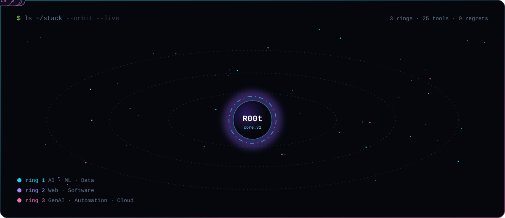

   

### `$ cat about.md`

Working full-time while studying **Applied Artificial Intelligence** part-time. I build across the whole stack of "make it real":
**generative AI & LLM workflows, automation & bots, websites & web apps, software, and data analysis**, from first idea to something people actually use.

I prefer execution over empty theory, working systems over vague concepts, and products over isolated experiments.

### `$ ls ~/stack --orbit`

<b>full stack as badges</b>

 

**AI · ML · Data** 

**Generative AI · Automation** 

**Web · Software** 

**Cloud · Infra** 

### `$ ls ~/projects`

  
  

  
  

  
  

  
  

<b>what I actually work on (long version)</b>

 

- **Generative AI & LLMs:** LLM workflows, agents and prompt pipelines that do real work instead of demos.
- **Automation & bots:** API integrations, rule-based and data-driven automation, trading bots, workflow systems.
- **Web & software:** websites, frontends and full apps with TypeScript and React, MVPs from idea to launch.
- **Data analysis & ML:** data prep, evaluation pipelines, classic ML, deep learning and the system around the model.
- **Computer vision & NLP:** face and emotion recognition, person detection, sentiment and text classification.
- **Cloud & deployment:** AWS, Google Cloud, Terraform, Docker; getting things out of the notebook and into production.
- **Product & brand:** positioning, MVP thinking and turning technical work into something people want to use.

### `$ git log --stats`

<picture>
  <source media="(prefers-color-scheme: dark)" srcset="https://raw.githubusercontent.com/Danielkis97/Danielkis97/output/snake-dark.svg" />
  <source media="(prefers-color-scheme: light)" srcset="https://raw.githubusercontent.com/Danielkis97/Danielkis97/output/snake-light.svg" />
  
</picture>

