<div align="center">


</div>



### `$ cat about.md`

**Full-time job by day. Applied AI student by night. Builder in between.**

I turn ideas into things that actually run: **LLM-powered tools, automations that kill busywork, bots, websites & web apps, and data pipelines that answer real questions.** Notebook → API → product, no stopping halfway.

```diff
+ shipped           > perfect
+ working systems   > slide decks
+ real users        > toy datasets
- "we should build that someday"
```



### `$ ls ~/stack`

<table align="center">
<tr><td><code>AI · ML · Data</code></td><td>       </td></tr>
<tr><td><code>GenAI · Automation</code></td><td>     </td></tr>
<tr><td><code>Web · Software</code></td><td>       </td></tr>
<tr><td><code>Cloud · Infra</code></td><td>     </td></tr>
</table>


### `$ ls ~/projects`

<p align="center">
  <a href="https://github.com/Danielkis97/Model-to-Production-IoT-Anomalies"></a>
  <a href="https://github.com/Danielkis97/Age-Gender-and-Emotion-Recognition-Local-Edge-Application"></a>
</p>
<p align="center">
  <a href="https://github.com/Danielkis97/Video-Object-Detection"></a>
  <a href="https://github.com/Danielkis97/Sentiment-Analysis-of-Movie-Reviews-Using-Machine-Learning"></a>
</p>
<p align="center">
  <a href="https://github.com/Danielkis97/Terraform-AWS-Cloud-Infrastructure"></a>
  <a href="https://github.com/Danielkis97/Superspeed-Seeds-Racing-Royale"></a>
</p>
<p align="center">
  <a href="https://github.com/Danielkis97/2024_Project_Habit_Tracking_App"></a>
  
</p>

<details>
<summary><b>what I actually work on (long version)</b></summary>
<br />

- **Generative AI & LLMs:** LLM workflows, agents and prompt pipelines that do real work instead of demos.
- **Automation & bots:** API integrations, rule-based and data-driven automation, trading bots, workflow systems.
- **Web & software:** websites, frontends and full apps with TypeScript and React, MVPs from idea to launch.
- **Data analysis & ML:** data prep, evaluation pipelines, classic ML, deep learning and the system around the model.
- **Computer vision & NLP:** face and emotion recognition, person detection, sentiment and text classification.
- **Cloud & deployment:** AWS, Google Cloud, Terraform, Docker; getting things out of the notebook and into production.
- **Product & brand:** positioning, MVP thinking and turning technical work into something people want to use.

</details>


### `$ git log --stats`




<div align="center">

</div>
